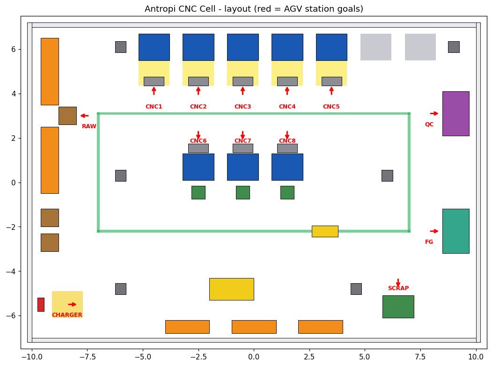

# Antropi CNC Cell: Autonomous TurtleBot3 Navigation

TurtleBot3 (waffle) acting as an AGV in a scaled-down CNC machining cell, navigating autonomously with ROS 2 Jazzy, Gazebo Harmonic and Nav2. Inspired by the AGV material-flow use case on Antropi's public website (no internal knowledge assumed).

**Demo video:** VIDEO_LINK_HERE


## What is in this repo
- **Custom Gazebo world** (20 m x 14 m): 8 CNC machines, raw store, QC station, finished-goods dock, charger, pillars, a parked forklift and a pallet jack in the return lane. It is generated from code (`scripts/generate_world.py`) using only boxes and cylinders, so nothing needs downloading.
- **Map** built with SLAM Toolbox by driving the robot manually (`maps/`).
- **Nav2 configuration** (`config/nav2_params.yaml`): Jazzy defaults, with the local controller changed from MPPI to Regulated Pure Pursuit.
- **Patrol script** (`scripts/patrol.py`): sends the robot to named stations through Nav2's `NavigateToPose` action. Station goals are in `config/stations.yaml`.

## Layout


Layout ideas taken from published AGV and CNC cell practice: forward-flowing material path (raw store, then machines, then QC, then finished goods), cells with a load station each, clearance in front of machines, and a loop-shaped vehicle route. The loop is drawn on the floor, but Nav2 does not enforce one-way rules.

## Requirements
Ubuntu 24.04, ROS 2 Jazzy, Gazebo Harmonic.

```bash
sudo apt install ros-jazzy-desktop ros-jazzy-navigation2 ros-jazzy-nav2-bringup \
  ros-jazzy-nav2-minimal-tb3-sim ros-jazzy-ros-gz ros-jazzy-slam-toolbox \
  ros-jazzy-teleop-twist-keyboard
echo "export TURTLEBOT3_MODEL=waffle" >> ~/.bashrc && source ~/.bashrc
```

## Setup
The scripts expect the repo at `~/ros2_ws/src/antropi_nav_demo`.

```bash
mkdir -p ~/ros2_ws/src
git clone https://github.com/toonpurkasuperhero/antropi-nav-demo.git ~/ros2_ws/src/antropi_nav_demo
```

## Run the demo
Terminal 1 (starts Gazebo, RViz and Nav2 with the custom world and map):

```bash
ros2 launch nav2_bringup tb3_simulation_launch.py \
  slam:=False headless:=False \
  params_file:=$HOME/ros2_ws/src/antropi_nav_demo/config/nav2_params.yaml \
  map:=$HOME/ros2_ws/src/antropi_nav_demo/maps/antropi_cnc_cell.yaml \
  world:=$HOME/ros2_ws/src/antropi_nav_demo/worlds/antropi_cnc_cell.sdf \
  x_pose:=-8.4 y_pose:=-5.5 yaw:=0.0
```

Wait about 2 minutes. Terminal 2 (the robot starts at the charger, which is the map origin):

```bash
python3 ~/ros2_ws/src/antropi_nav_demo/scripts/patrol.py --init RAW CNC3 CNC7 QC FG CHARGER
```

You can also click **2D Pose Estimate** and **Nav2 Goal** in RViz.

## Results
Patrol from the charger area to six stations (RPP controller, speed 0.35 m/s, goal tolerance 0.25 m):

| Station | Status | Distance from goal (m) | Time (s) |
|---|---|---|---|
| RAW | SUCCEEDED | 0.22 | 42 |
| CNC3 | SUCCEEDED | 0.21 | 42 |
| CNC7 | SUCCEEDED | 0.22 | 15 |
| QC | SUCCEEDED | 0.23 | 47 |
| FG | SUCCEEDED | 0.21 | 33 |
| CHARGER | SUCCEEDED | 0.15 | 93 |

6 of 6 stations reached. Times are wall-clock on a VM.

## Challenges and learnings
- **Initial pose matters.** A pose set about 0.9 m off made Nav2 think the robot sat inside the charger's cost area, so every plan failed.
- **Controller choice.** With the default MPPI controller the commanded speed stayed near zero. Switching to Regulated Pure Pursuit made the robot drive. MPPI was probably too heavy for the VM, but I did not prove that.
- **SLAM drift.** My first map had doubled walls from fast spins. A second, slow run produced a clean map.
- **Map frame.** SLAM puts the map origin at the robot's start pose, so station goals are stored relative to the charger.
- **Gazebo keeps the last command.** A manual `/cmd_vel` test kept the robot rolling until I sent a zero command.

## Limitations and future work
Planned but not implemented: a moving worker obstacle, a task scheduler, an automatic initial pose in the Nav2 parameters, and tuned speed. If Navigation shows "inactive" after launch, set the pose with 2D Pose Estimate at the robot, or reset the navigation nodes:

```bash
ros2 service call /lifecycle_manager_navigation/manage_nodes nav2_msgs/srv/ManageLifecycleNodes "{command: 3}"
ros2 service call /lifecycle_manager_navigation/manage_nodes nav2_msgs/srv/ManageLifecycleNodes "{command: 0}"
```

## Repo structure
`worlds/` Gazebo world, `maps/` saved map, `config/` Nav2 parameters and station goals, `scripts/` world generator, patrol and diagnostic scripts, `docs/` screenshots and notes.
